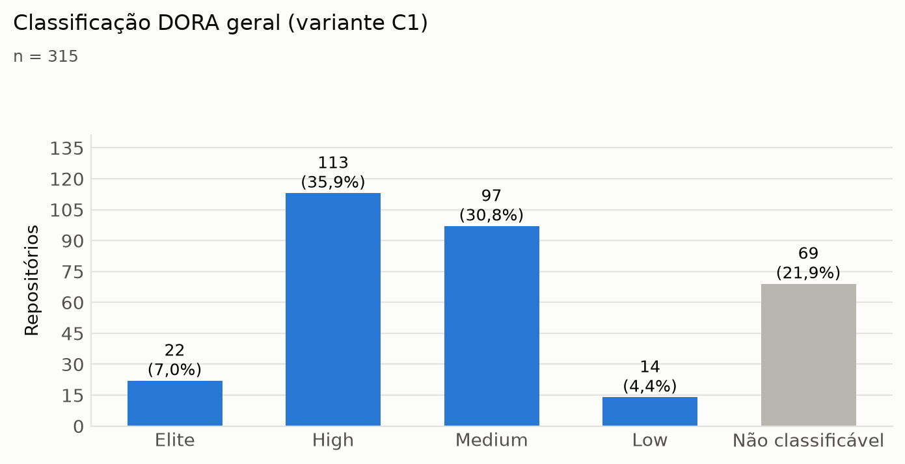
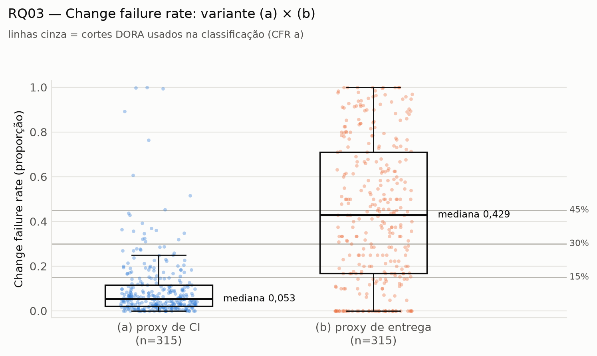
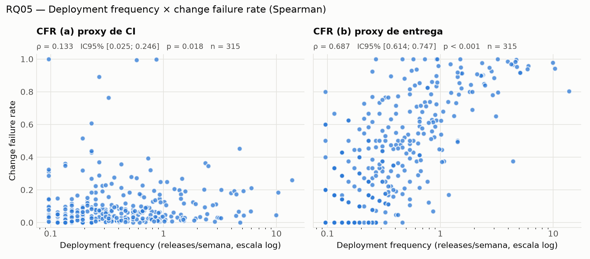
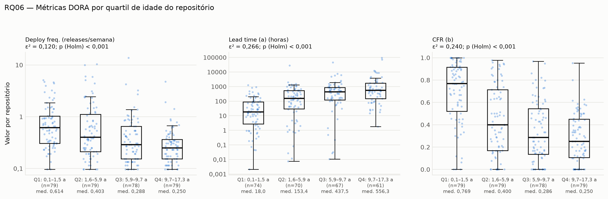

# Mineração de métricas DORA em repositórios open-source

## O quanto podemos confiar nos proxies?

**Grupo:** Bernardo Souza Alvim · Luísa Oliveira Jardim · Pedro Augusto Santos Seabra  
**Disciplina:** Laboratório de Experimentação de Software  
**Professor:** Danilo Maia  
**Repositório:** [Lab-Experimentacao-e-Medicao-](https://github.com/luisajardim/Lab-Experimentacao-e-Medicao-) · artigo completo em `Enunciado 3/RELATORIO.pdf`

> **Roteiro de 7 minutos:** Bernardo abre (≈ 2 min) → Luísa apresenta RQ01–RQ04 (≈ 2,5 min) → Pedro apresenta RQ05–RQ08 e fecha (≈ 2,5 min).
> Em cada seção, a **frase-chave** em destaque é o que precisa ser dito; o resto é apoio.

---

# 1. O problema e o método — *Bernardo, ≈ 2 min*

> **Frase-chave:** o GitHub não registra deploy nem falha em produção. Medimos por **proxies** e testamos o quanto dá para confiar neles.

As quatro métricas DORA medem velocidade e estabilidade da entrega:

| Métrica DORA | Proxy usado |
| :--- | :--- |
| Deployment frequency | releases publicadas por semana |
| Lead time for changes | release − data do commit |
| Change failure rate | (a) runs de CI com falha · (b) release seguida de correção em até 7 dias |
| Tempo de recuperação | da primeira falha de CI até o próximo sucesso |

**Amostra:** 12.000 resultados de busca → 761 elegíveis (≥ 5 releases e ≥ 50 runs em 12 meses) → **315 repositórios**, sorteados com semente fixa. Janela: out/2025 a set/2026.

**Validação:** três avaliadores rotularam 300 releases de 60 repositórios, e comparamos esses rótulos com a heurística automática de "release corretiva".

---

# 2. Como os repositórios entregam — *Luísa, ≈ 2,5 min*

> **Frase-chave:** o repositório típico publica **uma release a cada 3 semanas**, leva **cerca de 1 semana** do commit à release e recupera falhas de CI em **cerca de 3 horas**.

| RQ | Métrica | Mediana | IQR |
| :--- | :--- | ---: | :--- |
| RQ01 | Deployment frequency | **0,35 release/semana** | 0,19–0,77 |
| RQ02 | Lead time (a) por release | **166 h** (≈ 7 dias) | 23–626 h |
| RQ02 | Lead time (b) por commit | **152 h** (≈ 6 dias) | 25–404 h |
| RQ03 | CFR (a), proxy de CI | **5,3%** | 2,0–11,6% |
| RQ03 | CFR (b), proxy de entrega | **42,9%** | 16,7–71,0% |
| RQ04 | Tempo de recuperação | **3,3 h** | 0,6–17,7 h |

**O que mostrar no gráfico:** a maioria fica em **High (36%) e Medium (31%)**, só 7% são Elite, e 22% não podem ser classificados porque falta alguma métrica.

**O ponto principal da RQ03:** os dois proxies contam histórias opostas, com 5% de falha no CI e 43% na entrega. O valor de 43% é um **limite superior**: a heurística de release corretiva tem **F1 = 0,57** (precisão 0,44), e nem os avaliadores concordaram bem (κ = 0,60).

---

# 3. Velocidade × estabilidade e robustez — *Pedro, ≈ 2,5 min*

## RQ05 — Quem entrega mais falha mais?

> **Frase-chave:** **sim**, entre repositórios, quem entrega mais também falha mais, ao contrário do que o DORA afirma.

- CFR (a): ρ = **0,13** (fraca, p = 0,018)
- CFR (b): ρ = **0,69** (forte, p < 0,001), com uma parte mecânica: mais releases significam mais chance de uma correção em até 7 dias.

## RQ06 — O que explica? A idade do projeto.

Projetos **jovens** entregam mais, com lead time de 18 h (contra 556 h nos antigos), recuperam mais rápido e corrigem mais. Projetos **maduros** são lentos e estáveis. Popularidade e tipo do projeto não fizeram diferença (Kruskal-Wallis + Holm).

## RQ07 e RQ08 — Robustez e tendência

- **RQ07:** a classificação muda em **11–24%** dos repositórios quando a definição muda (κ ponderado 0,67–0,84). Contar tags como deploy **só melhora** categorias.
- **RQ08:** *rework rate* mediano de 0,77. Ao longo do ano, mais repositórios **melhoram** do que pioram (escala mensal). Dentro de cada repositório, o *trade-off* da RQ05 não se repete.

---

# Síntese final

- Releases a cada ~3 semanas, ~1 semana de lead time, recuperação em horas: a maioria fica em **High/Medium**.
- A taxa de falha **depende do proxy**: 5% no CI e 43% na entrega, sendo este um limite superior.
- Entre repositórios, entregar mais se associa a falhar mais, e a **idade do projeto** está por trás disso.
- A classificação DORA é **razoavelmente robusta**, mas não neutra à definição operacional.

**Principais limitações:** release não é deploy; a heurística de release corretiva ficou abaixo da meta (F1 = 0,57); um dos três avaliadores foi um modelo de linguagem.

## Mensagem principal

> **Dá para minerar métricas DORA de repositórios abertos, mas o número só tem sentido junto com a definição usada para medi-lo: o proxy escolhido muda a taxa de falha de 5% para 43%.**

---

## Cola rápida para perguntas

| Se perguntarem… | Resposta curta |
| :--- | :--- |
| Por que mediana e não média? | As métricas são muito assimétricas, com repositórios extremos. Mediana e IQR não são distorcidos por eles. |
| Por que o CFR (b) não entrou na classificação DORA? | Com F1 = 0,57, a mudança de categoria refletiria o erro da heurística, não a definição de deploy. |
| E os episódios de falha não recuperados? | São tratados como **censura**: 76 de 7.062 (1,1%). A curva de Kaplan-Meier dá mediana de 4,4 h, próxima da ingênua (3,3 h). |
| O F1 abaixo de 0,70 invalida o estudo? | Não. Documentamos quatro versões e 197 combinações; o próprio gabarito humano teve κ = 0,60. Por isso, o CFR (b) é reportado como limite superior. |
| Como reproduzir? | `uv sync` e os estágios `metrics`/`report`: sem token, a partir do manifesto e dos JSONs versionados (passo a passo no README). |
