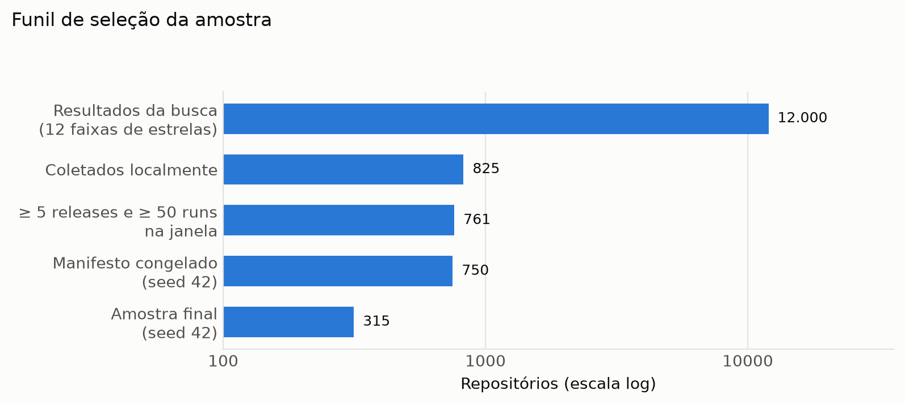
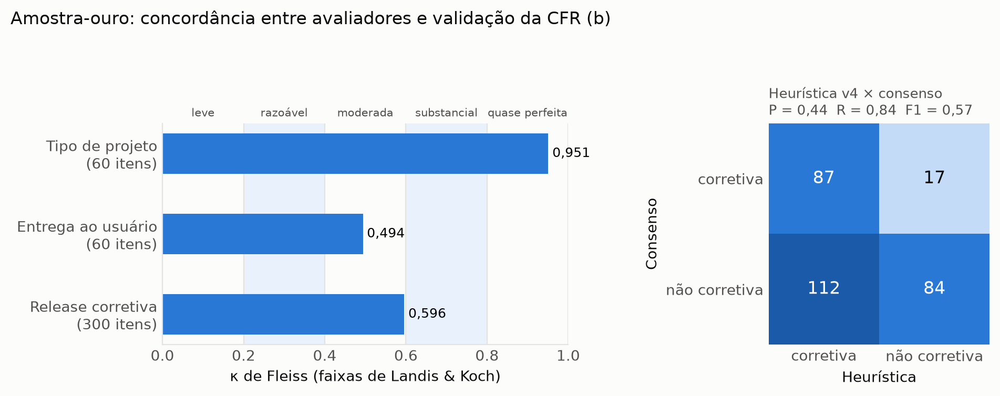
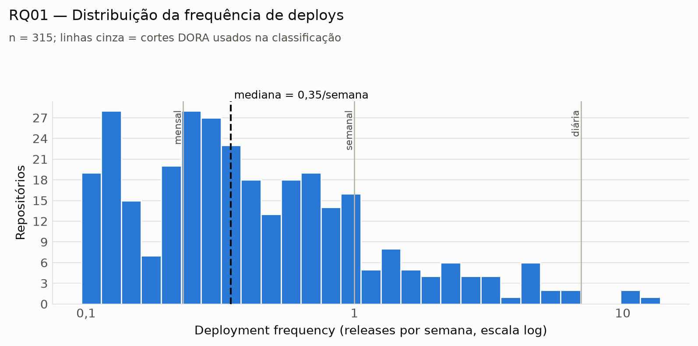
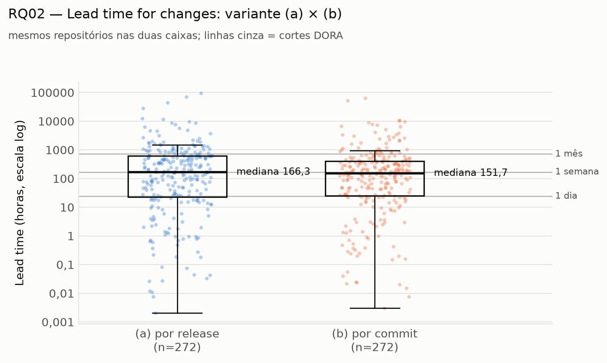
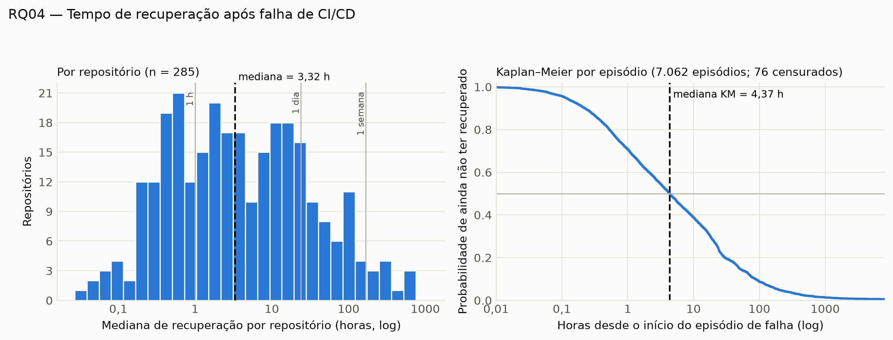
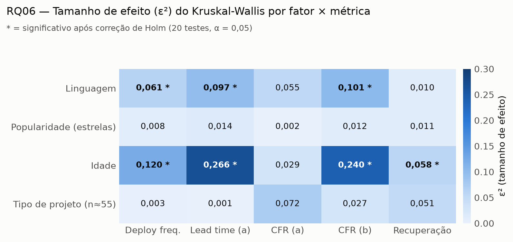
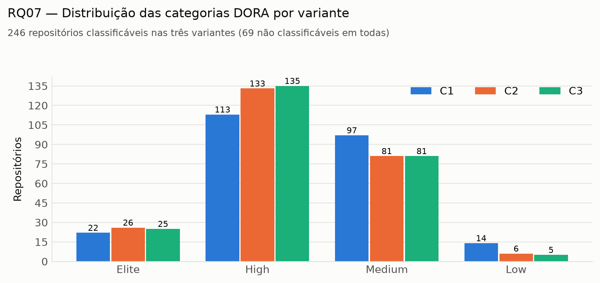
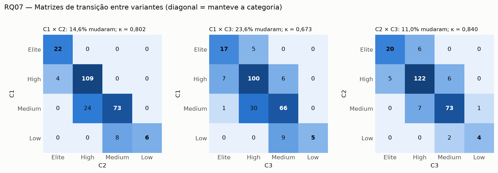
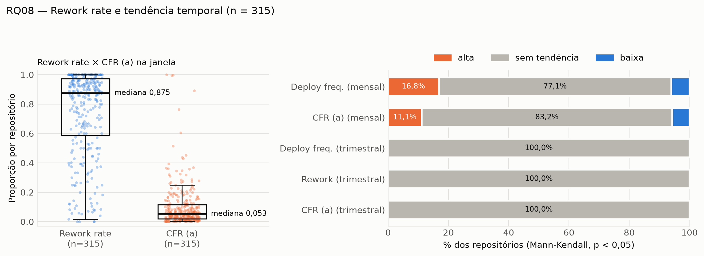

# Relatório de Laboratório

**Laboratório de Experimentação de Software — Lab03: Mineração de Métricas DORA**

---

| Campo | Informação |
| :--- | :--- |
| **Curso** | Engenharia de Software |
| **Disciplina** | Laboratório de Experimentação de Software |
| **Turno / Período** | Noite / 6º |
| **Professor(a)** | Danilo Maia |
| **Laboratório** | Lab03 — Mineração de Métricas DORA |
| **Grupo (trio)** | Bernardo Souza Alvim (859148) · Luísa Oliveira Jardim (843759) · Pedro Augusto Santos Seabra (812784) |
| **Link do repositório / GitHub Projects** | [preencher — obrigatório em todos os laboratórios] |
| **Data de entrega** | [preencher] |

---

## 1. Introdução

> *ORIENTAÇÃO: Contextualize, em 1-2 parágrafos, o problema geral que motiva este laboratório específico (ex.: falta de evidência controlada sobre o real impacto de assistentes de IA na programação — Lab02; métricas DORA como padrão de mercado para desempenho de entrega — Lab03; o Kanban do próprio grupo como objeto de estudo, em vez de um sistema externo — Lab05).*
>
> *Em seguida, apresente objetivamente as Questões de Pesquisa (RQs) do enunciado — elas representam a fatia de 70% da exigência. Para os laboratórios que pedem explicitamente hipóteses informais antes da coleta (Lab01, Lab03), inclua-as aqui, uma por RQ.*
>
> *Finalize citando, em uma frase por item, as RQs, métricas ou variáveis adicionais que o grupo decidiu propor por conta própria (os 30% de inovação) — o detalhamento delas vem na Metodologia.*

### Perguntas que esta seção deve responder ao leitor:
- Qual problema está sendo investigado, e por que ele importa (para a engenharia de software, para o mercado, ou para o próprio grupo)?
- Quais são as Questões de Pesquisa do enunciado (numeradas RQ1, RQ2, ...)?
- Quais as hipóteses informais do grupo para cada RQ, antes de olhar os dados (quando aplicável ao laboratório)?
- Quais RQs, métricas ou variáveis o grupo está propondo além do enunciado (resumo de 1 linha cada — os 30% de inovação)?

As métricas DORA tornaram-se o padrão de mercado para medir o desempenho de entrega de software, popularizadas pelo livro *Accelerate* (Forsgren, Humble & Kim, 2018) e atualizadas anualmente pelo relatório *Accelerate State of DevOps*. No entanto, boa parte da discussão sobre desempenho de equipes ainda se apoia em relatos qualitativos ou em dados de empresas específicas, dificultando comparações objetivas e reprodutíveis em escala aberta. Este laboratório busca contribuir para essa lacuna minerando automaticamente as quatro métricas clássicas (deployment frequency, lead time for changes, change failure rate e tempo de recuperação) a partir de repositórios open-source reais que usam CI/CD com GitHub Actions, permitindo uma análise empírica, replicável e estatisticamente fundamentada.

**Questões de Pesquisa do enunciado:**

- **RQ 01.** Qual a frequência de deploys dos repositórios populares que usam CI/CD?
- **RQ 02.** Qual o tempo entre um commit e seu respectivo deploy?
- **RQ 03.** Qual a taxa de falha das mudanças entregues por esses repositórios?
- **RQ 04.** Qual o tempo de recuperação após uma execução de CI/CD com falha?
- **RQ 05.** Repositórios com maior frequência de deploy apresentam maior ou menor taxa de falha?
- **RQ 06.** Quais características dos repositórios estão associadas a um melhor desempenho DORA?
- **RQ 07.** O quanto a classificação DORA de um repositório depende da definição operacional escolhida? (análise de sensibilidade)
- **RQ 08 (bônus).** Escolha uma das opções: rework rate ou evolução temporal via Mann-Kendall.

**Hipóteses informais do grupo (antes da coleta):**

- **RQ 01.** Esperamos encontrar uma distribuição assimétrica: a maioria dos repositórios populares terá deployment frequency baixa (semanal ou mensal), com poucos projetos atingindo frequência diária ou maior.
- **RQ 02.** A variante (a) por release tenderá a ter mediana maior que a variante (b) por commit, porque releases isoladas podem carregar commits antigos esquecidos, enquanto a mediana por commit dilui esses outliers.
- **RQ 03 (a).** A proxy de CI provavelmente superestimará a taxa de falha em relação à proxy de entrega (b), pois falhas de pipeline são mais frequentes que falhas em produção.
- **RQ 03 (b).** A heurística de release corretiva baseada em patch-only terá recall baixo e precisão alta; esperamos precisão acima de 70%, mas recall abaixo de 50%.
- **RQ 04.** Repositórios com mais workflow runs terão tempo de recuperação menor, por possuírem equipes com cultura de resposta mais rápida.
- **RQ 05.** Esperamos uma correlação de Spearman fraca ou moderada, possivelmente negativa, confirmando a afirmação do DORA de que velocidade e estabilidade não são um trade-off.
- **RQ 06.** Projetos classificados como biblioteca/framework terão melhor desempenho DORA que ferramentas CLI ou aplicações, por possuírem ciclos de release mais maduros.
- **RQ 07.** A análise de sensibilidade mostrará que repositórios classificados como Elite são robustos às mudanças de definição, enquanto repositórios na fronteira Medium/Low mudarão frequentemente de categoria.
- **RQ 08.** Esperamos que a proporção de repositórios com tendência significativa de melhora seja maior que a de piora, refletindo amadurecimento contínuo dos projetos populares.

**Inovações propostas pelo grupo (30%):**

- **Métrica adicional (rework rate + Mann-Kendall):** implementamos as duas opções do bônus RQ 08 (o enunciado pede uma), fornecendo uma visão mais completa da saúde do pipeline.
- **Metodologia complementar (Kaplan-Meier + bootstrap BCa):** para o tempo de recuperação censurado, aplicamos análise de sobrevivência de Kaplan-Meier e intervalos de confiança via bootstrap BCa, técnicas não exigidas pelo enunciado que aumentam a robustez estatística das conclusões.
- **Metodologia complementar (post-hoc de Dunn):** nos Kruskal-Wallis significativos da RQ 06, identificamos quais pares de grupos diferem (teste de Dunn com correção de Holm e δ de Cliff por par).
- **Arquitetura de coleta:** paralelização da coleta com `ThreadPoolExecutor`, pool de tokens e cache SQLite content-addressed com retomada por estágio.

---

## 2. Contexto

> *ORIENTAÇÃO: Situe o leitor no cenário do estudo. Primeiro, o contexto acadêmico: em qual momento do semestre este laboratório se encontra e como ele se conecta aos anteriores (ex.: “este é o Lab04, que consome os dados de mineração do Lab03 e os snapshots do Kanban mantidos desde o Lab01”).*
>
> *Segundo, o contexto do objeto de estudo em si: o que exatamente está sendo medido (os 1.000 repositórios mais populares do GitHub — Lab01; o processo de resolução de katas com e sem IA — Lab02; repositórios com CI/CD via GitHub Actions — Lab03; o board Kanban do próprio grupo — Lab04/Lab05).*
>
> *Cite aqui referências conceituais relevantes usadas como base teórica (ex.: o livro Accelerate, de Forsgren, Humble & Kim, para métricas DORA; o método GQM de Basili, Caldiera & Rombach para o meta-laboratório; o índice usado para “linguagens mais populares” no Lab01 — TIOBE, GitHut ou GitHub Octoverse, mantendo a mesma fonte do início ao fim).*

Este laboratório integra a disciplina de Laboratório de Experimentação de Software, do curso de Engenharia de Software, turno noturno, 6º período. O Lab03 é o terceiro de uma sequência de cinco laboratórios que combinam coleta automatizada de dados, análise estatística e escrita científica progressiva. Diferente dos laboratórios anteriores, este trabalho concentra-se exclusivamente na mineração de métricas de desempenho de entrega a partir de dados públicos de repositórios open-source, sem depender de processos internos de times reais.

O objeto de estudo é composto por repositórios populares do GitHub que utilizam GitHub Actions como ferramenta de CI/CD. A partir desses projetos, coletamos releases, commits entre releases, workflow runs e tags para calcular as métricas DORA de forma automatizada e replicável. A janela de observação é de 12 meses, com datas fixadas pelo professor, e a amostra mínima exigida é de 300 repositórios após os filtros de qualidade.

**Referências conceituais:**
- FORSGREN, N.; HUMBLE, J.; KIM, G. *Accelerate: The Science of Lean Software and DevOps*. IT Revolution, 2018.
- DORA. [DORA's software delivery metrics: the four keys](https://dora.dev/guides/dora-metrics-four-keys/).
- WOHLIN, C. et al. *Experimentation in Software Engineering*. Springer, 2012.

---

## 3. Metodologia

> *ORIENTAÇÃO: Esta é a seção mais longa do relatório e a que mais evidencia o trabalho real do grupo. Ela tem seis subseções — as cinco primeiras cobrem principalmente os 70% do enunciado; a última (Inovações) é onde os 30% de contribuição própria do grupo devem ficar explícitos e fáceis de identificar na correção.*

### 3.1 Principais Desafios

> *ORIENTAÇÃO: Relate as dificuldades técnicas e metodológicas reais enfrentadas pelo grupo — não uma lista de trivialidades já resolvidas, e sim decisões difíceis de fato.*
>
> *Exemplos típicos, conforme o laboratório: limite de taxa (rate limit) da API do GitHub ao consultar milhares de repositórios ou workflow runs (Lab01/Lab03); paginação de grandes volumes de dados; ausência de histórico de mudança de status consultável via API no GitHub Projects, exigindo snapshots manuais recorrentes (todos os laboratórios); dificuldade de padronizar katas de dificuldade equivalente e evitar memorização de soluções pela IA (Lab02); ambiguidade na definição operacional de uma métrica, como lead time (Lab03); dados incompletos ou repositórios sem GitHub Actions habilitado (Lab03).*

- **Rate limit e volume de requisições:** a API REST do GitHub permite no máximo 1.000 resultados por query de busca e consome cota rapidamente ao coletar releases, commits e workflow runs de centenas de repositórios. Com 825 repositórios coletados (dos quais 315 compõem a amostra final), cada um com releases, tags, compares e runs (divididos em até 12 meses), o volume total de chamadas chega a dezenas de mil. O grupo implementou cache SQLite content-addressed com retomada por estágio, GraphQL em lote (até 20 aliases por requisição) para metadados e backoff exponencial (1 s, 2 s, 4 s, 8 s, até 5 tentativas) para mitigar esse risco.
- **Ambiguidade na definição operacional de release corretiva (CFR b):** não há uma classificação canônica de "release corretiva" na API do GitHub. O grupo precisou definir uma heurística automática (mudança de patch no SemVer + palavras-chave na mensagem de commit: `fix`, `revert`, `hotfix`) e validá-la contra uma amostra-ouro rotulada manualmente por três avaliadores independentes, chegando a um consenso. A heurística passou por quatro versões (v1: patch-only; v2: patch-only OU keyword; v3: pontuação ponderada com corte tunável; v4: v3 com `PATCH > 0` na própria tag e penalidade opcional para commits `feat`). Das 197 combinações testadas, a melhor no consenso foi a v4, com F1 = 0,57 (precisão 0,44; recall 0,84), abaixo da meta de 0,70 proposta no plano. A dificuldade aparece também nos próprios avaliadores: a concordância na dimensão "release corretiva" foi apenas moderada (κ = 0,60), o que indica que a classe é ambígua mesmo para humanos.
- **Censura no tempo de recuperação:** episódios de falha que não terminam dentro da janela de observação não podem ser descartados, pois isso subestimaria o tempo real de recuperação. O grupo implementou o rastreamento de episódios abertos (censurados) e reporta a proporção por repositório (`censored_proportion`). Além disso, aplicou análise de sobrevivência de Kaplan-Meier para lidar com dados censurados de forma estatisticamente adequada.
- **Paginação e limites de endpoint:** endpoints como `/search/repositories` e `/actions/runs` retornam no máximo 1.000 resultados por query, exigindo fatia por faixa de estrelas (12 fatias em `config.toml`) e divisão mensal da janela para workflow runs. A verificação de que nenhum mês atingiu o teto de 1.000 resultados é feita automaticamente pela coleta.
- **Validação manual em escala:** rotular 60 repositórios × 5 releases × 3 avaliadores, sem consultar os demais e sem ver a saída da heurística, exigiu a geração automática de planilhas com links diretos para cada release, dossiês por repositório (`data/gold/dossiers/`) e uma ferramenta de validação de schema (`scripts/label_tool.py`). A concordância foi medida com κ de Fleiss antes de qualquer discussão entre os avaliadores. Como a terceira rotulagem humana não foi feita a tempo, o avaliador B foi um modelo de linguagem (Claude, Anthropic), que rotulou os mesmos dossiês sem acesso às demais planilhas nem à heurística (`labels_B.audit.json`); isso é tratado como limitação na seção 4.3.

### 3.2 Tomadas de Decisão

> *ORIENTAÇÃO: Documente as decisões metodológicas do grupo e o raciocínio (trade-off) por trás de cada uma — não apenas a escolha final.*
>
> *Exemplos que os enunciados pedem explicitamente: o limite de WIP definido para a coluna Doing e sua justificativa (obrigatório em todo laboratório); qual assistente de IA foi usado e por quê, e como se garantiu o mesmo tratamento em todos os trials (Lab02); qual definição operacional de métrica foi adotada quando o enunciado permite variação, mantendo-a consistente para toda a amostra (ex.: lead time no Lab03); critério de inclusão/exclusão de repositórios na amostra; linguagem de programação escolhida em função da ferramenta de métricas estáticas disponíveis (CK exige Java; Radon para Python).*

- **Definição de deploy:** usamos apenas releases públicas (`draft=false`), excluindo pré-releases e tags sem release da definição principal. Tags com data entram como deploy apenas nas variantes C2 e C3 da RQ 07. A contagem de releases é feita exclusivamente dentro da janela de observação (2025-10-01 a 2026-09-30).
- **Data do commit:** usamos `commit.author.date` como definição operacional, conforme exigido pelo enunciado, e registramos como ameaça à validade a distorção causada por rebases e squash merges, que podem deslocar a data de autoria em relação à data real da entrega.
- **População congelada e amostra determinística:** para garantir reprodutibilidade, a população elegível foi congelada em `data/raw/candidate_manifest.csv` (750 repositórios, semente 42) e o estágio `metrics` sorteia deterministicamente os 315 da amostra final (semente 42). Uma nova execução não faz novas buscas na API.
- **Critério de inclusão:** repositórios com menos de 5 releases ou menos de 50 workflow runs válidos no default branch são descartados (funil de seleção na seção 4.1). A contagem de runs considera apenas execuções com `event=push` no default branch, ignorando conclusões `cancelled`, `skipped`, `neutral`, `action_required`, `stale` e execuções em andamento.
- **Heurística de release corretiva (CFR b):** combina dois sinais — versão de patch no SemVer e commits com `fix`, `revert` ou `hotfix` na mensagem. Um loop automático (`scripts/tune_cfr.py`) testou 197 combinações de versão (v1–v4), conjunto de palavras-chave, tipo de casamento (substring vs. palavra inteira), corte e penalidade para commits `feat`, escolhendo a de maior F1 sobre o consenso da amostra-ouro. A escolhida foi a **v4**: pontuação `1 · (PATCH > 0 na tag) + 2 · fração de commits com palavra-chave`, corretiva se ≥ 0,75 (palavras inteiras, sem penalidade `feat`). O F1 no consenso foi 0,57 (precisão 0,44; recall 0,84) e, em validação cruzada 5-fold por repositório (20 repetições), 0,53 em média. A heurística, portanto, superestima releases corretivas (112 falsos positivos em 300 releases); por isso, as conclusões apoiadas em CFR (b) são tratadas com cautela.
- **Classificação DORA:** usamos os cortes fixos definidos no enunciado, com pontos por categoria (Elite=4, High=3, Medium=2, Low=1) e categoria geral = mediana dos quatro valores, arredondada para baixo. As três variantes de definição operacional (C1, C2, C3) são calculadas para todo repositório, permitindo a análise de sensibilidade da RQ 07.
- **Cache e retomada:** toda resposta da API é persistida em SQLite com chave content-addressed (hash de método + URL + body). Uma coleta interrompida (rate limit, queda de rede, Ctrl+C) retoma do último estágio completo sem repetir chamadas. O relatório de staleness (`reports/staleness_search.json`) registra quantos repositórios mudaram desde a última coleta.
- **Paralelismo:** a coleta usa `ThreadPoolExecutor` com até 3 workers e pool rotativo de tokens (até 3 tokens configurados via `GITHUB_TOKEN`, `GITHUB_TOKENS` ou `config.toml`), distribuindo a cota da API e reduzindo o tempo de coleta.
- **Testabilidade:** as funções de cálculo das métricas (`src/metrics/`) são puras, sem I/O, e cobrem ≥ 80% do módulo com `pytest` + `pytest-cov`. Os fixtures (`tests/fixtures/`) contêm dados de entrada construídos à mão com resultados conhecidos, incluindo casos de borda obrigatórios (release sem commits novos, falha nunca recuperada, runs `cancelled`, repositório com uma única release).

### 3.3 Etapas

> *ORIENTAÇÃO: Descreva o processo de desenvolvimento em sprints, seguindo a estrutura do enunciado (ex.: Lab0XS01, S02, S03 + Relatório Final), com o que foi efetivamente entregue em cada uma e quem (qual integrante) foi responsável por qual parte — a correção do professor é feita a partir do board (GitHub Projects), então a divisão aqui deve refletir os Assignees reais das Issues, não uma divisão apenas narrativa.*
>
> *Inclua também a subseção “Configuração do processo” exigida em todos os laboratórios: as colunas do board (mínimo Backlog → To Do → Doing → Review → Done), a política de limite de WIP em uso, e uma captura de tela (print) do board ao final do laboratório, mostrando o fluxo real de trabalho do grupo.*

| Sprint | Entregas | Responsável(is) | Issues (nº) |
| :--- | :--- | :--- | :--- |
| **S01** (5 pt) | Scaffold do projeto (`pyproject.toml`, `config.toml`, CI); cliente GitHub REST/GraphQL com rate limit e backoff; cache SQLite content-addressed com retomada por estágio; busca de candidatos por 12 faixas de estrelas (1.600 candidatos); coleta de releases, tags, commits entre releases e workflow runs (divisão mensal); funções puras de lead time (a e b), CFR(a) e tempo de recuperação com censura; CLI `python -m pipeline` com subcomandos `collect`, `metrics`, `report`, `doctor`; testes unitários com fixtures e cobertura ≥ 80%; CI do grupo no GitHub Actions (matrix 3.12/3.13 + smoke test `--limit 2`). | **A:** seleção, funil e coleta de metadados · **B:** releases/tags/commits + lead time · **C:** workflow runs + CFR(a) + recovery + pytest + CI | T01–T10 |
| **S02** (5 pt) | Amostra-ouro de 60 repositórios (semente `random_state=42`); geração automática de planilha com links diretos por release; rotulagem independente por três avaliadores (`labels_A.csv`, `labels_B.csv`, `labels_C.csv`); cálculo de concordância com κ de Fleiss (3 dimensões: tipo, entrega, corretiva); consenso via maioria simples com desempate em reunião; heurística CFR(b) com 4 versões e loop de tuning automático (melhor F1 = 0,57); dataset completo com 315 repositórios (≥ 300 exigidos) em `dora_c1.csv`, `dora_c2.csv`, `dora_c3.csv`; dicionário de dados v1.0; script `diff_datasets` + template de Issue para replicação cruzada. | **A:** amostra-ouro + concordância + consenso · **B:** heurística CFR(b) + tuning · **C:** pipeline completo + dataset + dicionário | T11–T18 |
| **S03** (5 pt) | Análise estatística das RQ 01 a RQ 07: estatística descritiva (mediana e IQR) e classificação DORA; Kaplan-Meier para tempo de recuperação censurado com bootstrap BCa (2.000 amostras); correlações de Spearman (RQ 05); testes de Kruskal-Wallis/Mann-Whitney com correção de Holm e tamanhos de efeito (ε² e Cliff's delta) (RQ 06); análise de sensibilidade com κ de Cohen ponderado entre C1×C2×C3 (RQ 07); bônus RQ 08: rework rate e Mann-Kendall trimestral. | **A:** RQ01–RQ04 + classificação C1 + sobrevivência · **B:** RQ05 + RQ06 · **C:** RQ07 + RQ08 | T19–T24 |
| **Final** (5 pt) | Replicação cruzada: execução do pipeline de outro grupo sobre subamostra de 30 repositórios; comparação de métricas com diferença relativa e % de mesma classificação DORA; abertura de Issues de divergência no repositório autor; respostas às Issues recebidas com `pipeline doctor`; seção de ameaças à validade (4 categorias de Wohlin) e revisão final do artigo; snapshot do GitHub Projects. | **A:** execução do outro grupo · **B:** comparação + Issues · **C:** respostas + ameaças + revisão | T25–T28 |

**Configuração do processo.** O grupo utilizou o GitHub Projects (v2) como ferramenta de processo, com as colunas mínimas: `Backlog do Enunciado` → `Backlog da Sprint` → `Em Andamento` → `Concluído`. Cada tarefa do `PLAN.md` (T01–T28) foi registrada como Issue própria, com `Assignee` definido por integrante e referência explícita ao número da Issue em cada commit. A política de limite de WIP foi de **no máximo 4 Issues em `Doing` por integrante**, para evitar sobrecarga de tarefas paralelas com uma folga de 1 para tarefas em conjunto, como `T12 de Rótulos Independentes (#57)`. O quadro foi mantido atualizado semanalmente, com cartões movidos entre as colunas à medida que cada etapa era concluída e revisada.

### 3.4 Ferramentas

> *ORIENTAÇÃO: Liste as ferramentas usadas na coleta, processamento e análise de dados — sejam específicas (nome e versão quando relevante), não genéricas.*
>
> *Exemplos conforme o laboratório: GraphQL e/ou REST API do GitHub para mineração (Lab01/Lab03 — bibliotecas de terceiros para consulta à API não são permitidas, o script deve ser próprio do grupo); Python/Pandas para manipulação de dados; Matplotlib/Seaborn ou Plotly/Dash/Streamlit para visualização; CK, PMD ou Radon para métricas estáticas de código (Lab02); testes estatísticos como o de Wilcoxon para amostras pareadas (Lab02); ferramenta de BI (Power BI, Tableau, Looker Studio) caso o grupo não opte pelo dashboard em código (Lab04).*
>
> *Inclua também a ferramenta de processo, obrigatória em todos os laboratórios: GitHub Projects (v2), com o link do repositório/board do grupo.*

- **Coleta de dados (API do GitHub):** `httpx` (síncrono) como cliente HTTP, sem bibliotecas de terceiro para a API do GitHub (PyGithub/Octokit proibidos, conforme ENUNCIADO §4). REST com pagination pelo cabeçalho `Link: rel="next"` e GraphQL com requisições em lote (até 20 aliases por chamada) para metadados. Rate limit respeitado via leitura de `X-RateLimit-Remaining`/`X-RateLimit-Reset` e pausa automática quando a cota acabar. Backoff exponencial em erros 429/5xx (1 s, 2 s, 4 s, 8 s, até 5 tentativas).
- **Cache e persistência:** SQLite (`data/cache/api_responses.db`) com tabela `responses(url_hash, url, method, body, status, response_body, fetched_at)`, chave content-addressed, retomada por estágio e relatório de staleness (`reports/staleness_search.json`).
- **Processamento e cálculo de métricas:** Python 3.12 (com `uv` como gerenciador de ambientes e `uv.lock` para reprodutibilidade). Funções puras em `src/metrics/` (lead time, CFR, recovery, classificação DORA, Kaplan-Meier, Spearman) sem I/O, testadas com `pytest` + `pytest-cov` (cobertura ≥ 80%).
- **Análise estatística:** `pandas` (manipulação de dados), `scipy.stats` (Spearman, Kruskal-Wallis, Mann-Whitney), `statsmodels` (Fleiss' kappa, correção de Holm), `scikit-learn` (κ de Cohen ponderado, precisão/recall/F1), `lifelines` (Kaplan-Meier), `pymannkendall` (teste de Mann-Kendall para RQ 08), `matplotlib` (visualizações, geradas por `analysis/figures.py` e pelos scripts de cada RQ).
- **Validação manual:** `scripts/generate_gold.py` (gerador da planilha-ouro com links diretos por release), `scripts/label_tool.py` (validação de schema e auditoria de rotulagem), `scripts/agreement.py` (κ de Fleiss e consenso), `scripts/tune_cfr.py` (loop automático de tuning da heurística CFR(b)).
- **CI do grupo:** GitHub Actions em `.github/workflows/testes.yml` com matrix Python 3.12/3.13, `pytest --cov=metrics --cov-fail-under=80` e `ruff check src/ tests/`. Smoke test com `--limit 2` comprova o funcionamento end-to-end da coleta.
- **Ferramenta de processo:** GitHub Projects (v2) com quadro Kanban (Backlog do Enunciado → Backlog da Sprint → Em Andamento → Concluído), Issues vinculadas a cada tarefa do PLAN.md, Assignee por integrante e snapshot em CSV para auditoria.

### 3.5 Tabela de Métricas

> *ORIENTAÇÃO: Construa uma tabela relacionando cada Questão de Pesquisa à métrica correspondente, sua definição operacional exata (a fórmula ou regra de cálculo — não basta o nome) e a ferramenta/fonte usada para coletá-la. Isso é o que garante que o laboratório seja reprodutível por outro grupo. A primeira linha abaixo é um exemplo ilustrativo (baseado no Lab01); substitua pelas RQs e métricas do seu laboratório.*

| RQ | Métrica | Definição Operacional | Unidade | Ferramenta / Fonte |
| :--- | :--- | :--- | :--- | :--- |
| **RQ01** | Deployment frequency | Número de releases publicadas (`draft=false`) na janela ÷ número de semanas da janela (52,1) | Releases/semana | `src/metrics/deployment_frequency.py` + `src/collector/releases.py` |
| **RQ02 (a)** | Lead time por release | Mediana, por repositório, de `published_at(R) − author_date do commit mais antigo` em `compare/{release anterior}...{R}`. Releases sem anterior (primeira da história), com compare 404 ou sem commits novos são ignoradas. | Horas | `src/metrics/lead_time.py` + `src/collector/commits.py` |
| **RQ02 (b)** | Lead time por commit | Mediana de `published_at(R) − author_date(c)` para **todo** commit c de **todas** as releases R do repositório. | Horas | `src/metrics/lead_time.py` + `src/collector/commits.py` |
| **RQ03 (a)** | Change failure rate (proxy CI) | `falhas / (falhas + sucessos)` dos workflow runs. Falha = `failure`, `timed_out`, `startup_failure`; sucesso = `success`. Conclusões `cancelled`, `skipped`, `neutral`, `action_required`, `stale` e vazia são ignoradas. | proporção [0,1] | `src/metrics/cfr.py` + `src/collector/runs.py` |
| **RQ03 (b)** | Change failure rate (proxy entrega) | `nº de releases que falharam ÷ releases avaliadas`. Uma release R é **falha** se for seguida, em até 7 dias, por uma **release corretiva** (heurística v4: `1 · (PATCH > 0) + 2 · fração de commits com fix/revert/hotfix ≥ 0,75`). Releases dos últimos 7 dias da janela são censuradas e saem do denominador. | proporção [0,1] | `src/metrics/cfr_release.py` + validação manual (`data/gold/labels_consensus.csv`) |
| **RQ04** | Tempo de recuperação | Episódio começa na primeira falha **após um sucesso** e termina no próximo sucesso **do mesmo workflow**. Tempo = `updated_at do sucesso − run_started_at da primeira falha`. Valor do repositório = mediana dos episódios **não censurados**. Episódios que nunca terminam dentro da janela são censurados e reportados via `censored_proportion`. | Horas | `src/metrics/recovery.py` + `src/metrics/survival.py` (Kaplan-Meier) |
| **RQ05** | Correlação Spearman | ρ entre deployment frequency (RQ01) e CFR (RQ03 a e b), calculada separadamente para cada variante. | ρ, p-valor, n | `scipy.stats.spearmanr` (`src/metrics/correlation.py`) |
| **RQ06** | Diferença entre subgrupos | Kruskal-Wallis (≥3 grupos) ou Mann-Whitney (2 grupos) entre métricas DORA e fatores (linguagem, quartis de estrelas, contribuidores, idade, tipo do projeto). Correção de Holm para múltiplos testes. Tamanho de efeito: ε² (Kruskal-Wallis) e Cliff's delta (Mann-Whitney). | p-valor ajustado, ε², δ | `scipy.stats` + `statsmodels.stats.multipletests` |
| **RQ07** | Análise de sensibilidade | % de repositórios que mudam de categoria DORA entre as combinações C1×C2, C1×C3, C2×C3, e κ de Cohen ponderado (`weights='linear'`) entre as classificações. | %, κ | `sklearn.metrics.cohen_kappa_score` (`src/metrics/dora_classification.py`) |
| **RQ08 (bônus)** | Rework rate + Mann-Kendall | (i) Proporção de releases corretivas sobre o total de releases da janela (regra v2: patch-only OU commit com as palavras-chave calibradas). (ii) Teste de Mann-Kendall por repositório, por trimestre (exigido) e por mês (complementar), para verificar tendência de melhora/piora das métricas DORA. | proporção, p-valor, direção | `pymannkendall` + `src/metrics/cfr_release.py` |

### 3.6 Inovações Propostas pelo Grupo (30% da nota)

> *ORIENTAÇÃO: O enunciado do laboratório corresponde a 70% da exigência da disciplina. Os outros 30% dependem de uma contribuição original do grupo, que deve estar claramente identificada aqui — não diluída no restante do texto — para facilitar a correção.*
>
> *Escolha uma ou mais frentes de inovação, entre:*
> - *(a) uma nova Questão de Pesquisa, além das do enunciado;*
> - *(b) uma métrica ou variável adicional, não pedida no enunciado;*
> - *(c) uma mudança de arquitetura/ferramenta de coleta (ex.: paralelizar a coleta, usar cache, trocar de biblioteca de visualização);*
> - *(d) uma metodologia alternativa ou complementar (ex.: um teste estatístico adicional, uma segmentação diferente da amostra, uma técnica de controle de ameaça à validade não exigida pelo enunciado).*
>
> *Para cada inovação escolhida, explique o que foi feito, por que o grupo considerou relevante, e onde o resultado dela aparece nas seções de Resultados/Discussão e na Conclusão — inovação sem resultado discutido não conta como contribuição efetiva.*

- **Inovação 1 (metodologia complementar — análise de sobrevivência e bootstrap):** aplicação de Kaplan-Meier (`lifelines.KaplanMeierFitter`) para o tempo de recuperação censurado (episódios sem sucesso dentro da janela) e intervalo de confiança via bootstrap BCa (2.000 amostras) para medianas e IQRs. Essa técnica é comum em análise de confiabilidade, mas raramente aplicada a métricas de software, e aumenta a robustez das conclusões da RQ 04 frente a dados censurados. O resultado aparece em `data/datasets/metrics.csv` (colunas `survival_median_hours`, `survival_n_events`, `survival_n_censored`), na Figura 7 e é discutido na seção 4.3.
- **Inovação 2 (arquitetura de coleta — paralelismo + cache + pool de tokens):** implementação de `ThreadPoolExecutor` (até 3 workers) para queries paralelas de busca e coleta por repositório, cache SQLite content-addressed com retomada por estágio, e pool rotativo de até 3 tokens GitHub (via `GITHUB_TOKEN`, `GITHUB_TOKENS` ou `config.toml`) para distribuir a cota da API. Essa mudança reduz o tempo de coleta e garante que interrupções (Ctrl+C, rate limit, queda de rede) não exigem reinício do pipeline. O relatório de staleness (`reports/staleness_search.json`) quantifica quantos repositórios mudaram desde a última coleta.
- **Inovação 3 (bônus completo — rework rate e Mann-Kendall):** o enunciado pede uma das duas opções da RQ 08; implementamos as duas em `analysis/rq08_bonus.py`. O rework rate (métrica adicionada pelo DORA em 2024) é a proporção de releases corretivas sobre o total da janela. O teste de Mann-Kendall (`pymannkendall`) foi aplicado por repositório na escala trimestral pedida e, como contribuição própria, também na escala mensal, que tem poder estatístico suficiente para detectar tendências (seção 4.3).
- **Inovação 4 (metodologia — post-hoc de Dunn):** nos testes de Kruskal-Wallis significativos da RQ 06, aplicamos o teste de Dunn com correção de Holm e δ de Cliff por par, indicando *quais* grupos diferem e com que magnitude (Figura 10).
- **Inovação 5 (arquitetura — GraphQL em lote):** uso de GraphQL com aliases para múltiplas queries em uma única requisição (até 20 aliases por chamada), reduzindo round-trips para metadados dos repositórios em relação a chamadas REST individuais.
- **Inovação 6 (reprodutibilidade — diff-datasets + template de Issue):** scripts `scripts/diff_datasets.py` e `templates/issue_replicacao.md` automatizam a comparação de CSVs para a replicação cruzada (diferença relativa por métrica, % de mesma classificação DORA, template de Issue com comando executado, erro, valores esperados vs. obtidos). Isso torna a entrega final do ENUNCIADO §9 uma operação mecânica.
- **Inovação 7 (reprodutibilidade — manifesto congelado e pipeline doctor):** a população elegível fica fixada em `data/raw/candidate_manifest.csv` e os JSONs brutos por repositório são versionados em `data/gold/`, de modo que o estágio `metrics` reproduz exatamente os 315 repositórios e todas as métricas sem token nem acesso à API. O comando `python -m pipeline doctor` valida token, config, cache e dependências em um único passo.

---

## 4. Resultados

### 4.1 Coleta de Dados

> *ORIENTAÇÃO: Relate o volume final de dados efetivamente coletado e analisado — não apenas o volume-alvo do enunciado. Informe:*
> - *quantos itens restaram após os filtros de qualidade (ex.: dos 1.000 repositórios buscados, quantos tinham dados completos; dos repositórios candidatos, quantos de fato usavam GitHub Actions — Lab03);*
> - *o período coberto pela coleta;*
> - *quantos trials/execuções foram concluídos dentro do tempo (Lab02);*
> - *quantos snapshots do Kanban estão disponíveis e desde quando (Lab04/Lab05);*
> - *outliers ou dados ausentes identificados, e como foram tratados (removidos, mantidos e discutidos à parte, etc.).*

A janela de observação vai de **2025-10-01 a 2026-09-30** (12 meses). A busca por 12 faixas de estrelas retornou 12.000 repositórios candidatos; destes, 825 foram coletados localmente e **761** passaram nos filtros oficiais (≥ 5 releases publicadas na janela e ≥ 50 workflow runs válidos por `push` no default branch). Para tornar a coleta reprodutível, a população foi congelada em um manifesto de 750 repositórios (semente 42), do qual o estágio `metrics` sorteia deterministicamente a **amostra final de 315 repositórios** (semente 42), acima do mínimo de 300 exigido (Figura 1).

A amostra é diversa: estrelas entre 248 e 42.231 (mediana 2.881), idade entre 0,1 e 17,3 anos (mediana 5,9) e predominância de TypeScript (80), Python (53), Go (47), Rust (29) e JavaScript (20). Foram analisados 7.062 episódios de falha de CI, dos quais 76 (1,1%) ficaram abertos no fim da janela (censurados).

**Dados ausentes.** Nenhum repositório foi removido por valor extremo: como as métricas são fortemente assimétricas, todos os outliers foram mantidos e a análise usa mediana, IQR e testes não paramétricos. Os ausentes são estruturais e ficam explícitos:

| Métrica | n válido | Motivo da ausência |
| :--- | ---: | :--- |
| Deployment frequency, CFR (a), CFR (b) | 315 | — |
| Lead time (a) e (b) | 272 | 43 repositórios sem nenhum par de releases consecutivas com commits comparáveis (primeira release, compare 404 ou release sem commits novos) |
| Tempo de recuperação | 285 | 26 repositórios sem nenhum episódio de falha e 4 só com episódios censurados |
| Classificação DORA (C1) | 246 | 69 repositórios sem alguma das quatro métricas ficam "não classificáveis" |

**Amostra-ouro.** 60 repositórios (300 releases) foram rotulados por três avaliadores. A concordância (κ de Fleiss) foi quase perfeita para o tipo de projeto (κ = 0,95), moderada para "entrega ao usuário" (κ = 0,49, apesar de 59 dos 60 itens serem unânimes, efeito do desbalanceamento: quase todos são "sim") e moderada para "release corretiva" (κ = 0,60; 70% das releases unânimes). Todos os itens foram resolvidos por maioria, sem empates pendentes. Contra esse consenso, a melhor heurística de release corretiva atingiu precisão 0,44, recall 0,84 e F1 0,57 (Figura 2).

### 4.2 Visualização Gráfica

> *ORIENTAÇÃO: Para cada Questão de Pesquisa (do enunciado e das RQs de inovação do grupo), inclua ao menos uma visualização que a responda diretamente, com a pergunta enunciada em texto imediatamente antes do gráfico correspondente, eixos nomeados com clareza e a medida de tendência central adequada indicada (mediana costuma ser preferível a média quando há outliers ou distribuição assimétrica — comum em dados de repositórios de software).*
>
> *Use o tipo de gráfico adequado ao tipo de pergunta, conforme a tabela abaixo, e explicite no texto os valores-chave que aparecem no gráfico (não deixe o leitor “adivinhar” o número a partir da figura).*

| Tipo de pergunta / dado | Gráfico recomendado |
| :--- | :--- |
| Comparar uma métrica entre categorias (ex.: linguagem, benchmark DORA) | Barras (ranking) — ordenadas por valor, não alfabeticamente |
| Comparar dois tratamentos no mesmo grupo (ex.: com IA vs. sem IA) | Boxplot pareado ou gráfico de pontos conectados (before/after) |
| Distribuição de uma métrica numérica (ex.: idade dos repositórios) | Histograma ou boxplot |
| Relação entre duas métricas numéricas (ex.: RQ07 do Lab01, RQ05 do Lab03) | Gráfico de dispersão (scatter plot) |
| Evolução ao longo do tempo (ex.: cycle time por sprint) | Linha, com um ponto por sprint/snapshot |
| Composição/fluxo do Kanban ao longo do tempo (Cumulative Flow Diagram) | Área empilhada (uma camada por coluna do board) |
| Proporção de categorias (ex.: % de issues fechadas) | Barra única 100% ou barras simples — evite pizza com muitas fatias |

Todas as figuras são geradas a partir dos CSVs de `analysis/output/` por `uv run python analysis/figures.py` (a Figura 8 vem de `analysis/rq05_spearman.py`). Métricas assimétricas (frequência, lead time, recuperação) usam escala logarítmica, e a mediana está sempre marcada. Os ICs de 95% das medianas são bootstrap BCa (2.000 reamostragens, semente 42).

| RQ | Métrica | n | Mediana | IQR (Q1–Q3) | IC 95% da mediana |
| :--- | :--- | ---: | ---: | :--- | :--- |
| RQ01 | Deployment frequency (releases/semana) | 315 | 0,35 | 0,19–0,77 | 0,31–0,40 |
| RQ02 (a) | Lead time por release (h) | 272 | 166,3 | 22,7–626,0 | 118,5–247,7 |
| RQ02 (b) | Lead time por commit (h) | 272 | 151,7 | 24,8–404,3 | 120,1–187,8 |
| RQ03 (a) | CFR proxy de CI | 315 | 0,053 | 0,020–0,116 | 0,043–0,064 |
| RQ03 (b) | CFR proxy de entrega | 315 | 0,429 | 0,167–0,710 | — |
| RQ04 | Tempo de recuperação (h) | 285 | 3,32 | 0,63–17,71 | 2,38–4,89 |

#### RQ01: Qual a frequência de deploys dos repositórios populares que usam CI/CD?

A mediana é de **0,35 release por semana** (cerca de uma a cada 3 semanas). 28% dos repositórios publicam menos de uma release por mês, só 17,5% publicam semanalmente ou mais, e apenas 3 atingem a frequência diária (Figura 3). Na classificação DORA geral (C1), predominam High (35,9%) e Medium (30,8%), com 7,0% Elite e 4,4% Low (Figura 4).

#### RQ02: Qual o tempo entre um commit e seu respectivo deploy?

A mediana do lead time por release (a) é **166 h (≈ 7 dias)** e a do lead time por commit (b) é **152 h (≈ 6,3 dias)**. A variante (a) é maior que a (b) em 69% dos repositórios e tem dispersão bem maior (IQR de 603 h contra 380 h), porque mede o commit mais antigo de cada release. Metade dos repositórios entrega em menos de uma semana e um quarto em menos de um dia (Figura 5).

#### RQ03: Qual a taxa de falha das mudanças entregues por esses repositórios?

As duas proxies contam histórias muito diferentes (Figura 6). Pela proxy de CI (a), a mediana é **5,3%** de runs com falha e 80% dos repositórios ficam no corte Elite (≤ 15%). Pela proxy de entrega (b), a mediana é **42,9%** das releases seguidas por uma release corretiva em até 7 dias, e só 22,5% ficam abaixo de 15%. O valor de (b) está inflado pela heurística, que tem precisão de 0,44 (seção 4.3).

#### RQ04: Qual o tempo de recuperação após uma execução de CI/CD com falha?

A mediana por repositório é de **3,3 h** (IC 95%: 2,4–4,9 h): 31% dos repositórios recuperam em menos de 1 hora e 81% em menos de 1 dia. Considerando todos os 7.062 episódios, inclusive os 76 censurados, a curva de Kaplan-Meier dá uma mediana de **4,4 h** (Figura 7). Como a censura é baixa (1,1% dos episódios), a mediana ingênua e a de Kaplan-Meier são próximas.

#### RQ05: Repositórios com maior frequência de deploy apresentam maior ou menor taxa de falha?

A correlação de Spearman é **positiva** nas duas variantes (Figura 8): fraca para CFR (a) (ρ = 0,13; IC 95%: 0,02–0,25; p = 0,018) e forte para CFR (b) (ρ = 0,69; IC 95%: 0,61–0,75; p < 0,001), com n = 315 em ambas.

#### RQ06: Quais características dos repositórios estão associadas a um melhor desempenho DORA?

Foram feitos 20 testes de Kruskal-Wallis (4 fatores × 5 métricas), com correção de Holm (Figura 9). **Idade** é o fator mais associado ao desempenho: tem efeito significativo em quatro das cinco métricas, com efeitos relativamente fortes em lead time (ε² = 0,27) e CFR (b) (ε² = 0,24). **Linguagem** tem efeito moderado em deployment frequency, lead time e CFR (b). **Popularidade** (quartis de estrelas) e **tipo de projeto** não têm nenhum efeito significativo.

O post-hoc de Dunn mostra a direção do efeito da idade (Figura 10): o quartil mais jovem (até 1,5 ano) publica mais releases (mediana 0,61/semana contra 0,25 no mais antigo; δ = 0,56, grande), tem lead time muito menor (18 h contra 556 h; δ = −0,75, grande) e recupera mais rápido (1,5 h contra 10,8 h; δ = −0,35, médio), mas também tem CFR (b) muito maior (0,77 contra 0,25; δ = 0,73, grande). Entre linguagens, TypeScript tem lead time menor que Go (73 h contra 315 h; δ = 0,39) e maior CFR (b) que Go e "Outras" (δ ≈ −0,41 e −0,43).

#### RQ07: O quanto a classificação DORA de um repositório depende da definição operacional escolhida?

Entre os 246 repositórios classificáveis nas três variantes, **14,6%** mudam de categoria entre C1 e C2 (κ ponderado = 0,80), **23,6%** entre C1 e C3 (κ = 0,67) e **11,0%** entre C2 e C3 (κ = 0,84). Contar tags como deploy (C1 → C2) só melhora a classificação: 36 repositórios sobem e nenhum desce, esvaziando a categoria Low (14 → 6). Apenas 1 repositório salta dois níveis, no par C1 × C3 (Figuras 11 e 12).

#### RQ08 (bônus): Rework rate e evolução temporal via Mann-Kendall

O rework rate mediano é **0,875** (IQR 0,59–0,97), contra 0,053 do CFR (a). Na escala trimestral exigida (4 pontos por repositório), nenhum repositório apresenta tendência significativa. Na escala mensal (12 pontos), **16,8%** dos repositórios aumentam a frequência de deploy e 6,0% a reduzem; o CFR (a) aumenta em 11,1% e cai em 5,7% (Figura 13).

### 4.3 Discussão

> *ORIENTAÇÃO: Para cada RQ (do enunciado e das RQs de inovação do grupo), compare explicitamente a hipótese informal levantada na Introdução com o resultado efetivamente obtido — hipótese confirmada, refutada, ou parcialmente confirmada, e por quê.*
>
> *Quando houver teste estatístico (ex.: Wilcoxon no Lab02), reporte o valor obtido e interprete o que ele significa em linguagem acessível, não apenas o número bruto.*
>
> *Discuta as ameaças à validade específicas do laboratório (ex.: efeito de aprendizado entre katas e risco de memorização pela IA — Lab02; diferença de dificuldade entre laboratórios distintos confundindo a tendência de cycle time — Lab05; lacunas nos snapshots do Kanban — Lab05).*
>
> *Finalize relacionando o que as inovações do grupo (seção 3.6) acrescentaram: elas confirmaram, contradisseram ou aprofundaram o que os 70% do enunciado já mostravam?*

#### Hipóteses × resultados

| RQ | Hipótese informal | Resultado | Veredito |
| :--- | :--- | :--- | :--- |
| RQ01 | Distribuição assimétrica, maioria semanal/mensal, poucos diários | Mediana 0,35/semana; 28% abaixo de mensal; só 3 diários | **Confirmada** |
| RQ02 | Lead time (a) > (b) | Medianas 166 h × 152 h; (a) > (b) em 69% dos repositórios | **Confirmada** |
| RQ03 (a) | CFR de CI maior que CFR de entrega | CFR (a) 5,3% × CFR (b) 42,9% | **Refutada**, com ressalva sobre a precisão de (b) |
| RQ03 (b) | Heurística com precisão alta (> 70%) e recall baixo (< 50%) | Precisão 0,44 e recall 0,84 | **Refutada** (perfil inverso) |
| RQ04 | Mais atividade de CI ⇒ recuperação mais rápida | Mediana 3,3 h; ρ(deployment frequency, recuperação) = −0,17 (p = 0,005) | **Parcialmente confirmada** (efeito fraco, medido com frequência de deploy) |
| RQ05 | Correlação fraca/moderada, possivelmente negativa | ρ = +0,13 (a) e +0,69 (b) | **Refutada** quanto ao sinal |
| RQ06 | Biblioteca/framework com melhor desempenho | Tipo sem efeito significativo; idade é o fator dominante | **Refutada** |
| RQ07 | Elite robusto; fronteira Medium/Low instável | Elite C1 → C2 100% estável; 25% dos Medium e 57% dos Low mudam | **Confirmada** |
| RQ08 | Mais repositórios melhorando que piorando | Deploy freq. sobe em 16,8% × cai em 6,0%; CFR (a) piora em 11,1% × melhora em 5,7% | **Parcialmente confirmada** |

#### Interpretação por RQ

**RQ01–RQ02.** Os repositórios populares com CI/CD entregam com cadência moderada: a release típica sai a cada três semanas e leva cerca de uma semana do commit até a publicação. A diferença entre as variantes de lead time confirma que a mediana por release é puxada por commits antigos que ficam "esperando" a próxima release. A variante por commit (b) dilui esses casos e é mais estável. A cauda longa das duas variantes, com repositórios acima de 10.000 h, justifica o uso de mediana e IQR em vez de média.

**RQ03.** As duas proxies não são intercambiáveis. O CFR (a) mede falhas de pipeline, que os projetos corrigem rápido e em pequena proporção. O CFR (b) tenta medir falhas que chegam ao usuário, mas depende de uma heurística com muitos falsos positivos: 112 das 199 releases que ela marca como corretivas não o são no consenso. Assim, os 42,9% devem ser lidos como **limite superior**. Mesmo para os avaliadores a classe foi difícil (κ = 0,60), porque muitas releases misturam correções e funcionalidades ou não têm notas.

**RQ04.** A recuperação é rápida: o episódio típico de falha é resolvido no mesmo dia, e só 1,1% dos episódios fica aberto até o fim da janela. A curva de Kaplan-Meier (inovação) confirma a mediana ingênua (4,4 h × 3,3 h). Isso mostra que, nesta amostra, ignorar a censura não distorceria muito o resultado, uma conclusão que só é possível porque a censura foi tratada explicitamente.

**RQ05.** Ao contrário do relatório DORA, que afirma não haver *trade-off* entre velocidade e estabilidade, aqui quem entrega mais também falha mais. O efeito é fraco no CI (ρ = 0,13) e forte na entrega (ρ = 0,69). Parte da correlação de (b) é, porém, estrutural: com mais releases, aumenta a chance mecânica de uma release ser seguida por outra corretiva em até 7 dias, e a heurística favorece versões de patch, que são justamente as mais frequentes. Por isso, a força de ρ (b) não deve ser interpretada como relação causal.

**RQ06.** O fator mais associado ao desempenho é a **maturidade do projeto**, não sua popularidade nem seu tipo. Projetos jovens se comportam como "startups": entregam com mais frequência, com lead time curto e recuperação rápida, mas com mais releases corretivas. Projetos antigos são mais lentos e estáveis. Esse padrão é coerente com a correlação positiva da RQ05. A ausência de efeito do tipo de projeto deve ser lida com cuidado: só os 55 repositórios da amostra-ouro têm tipo rotulado, então o teste tem pouco poder estatístico.

**RQ07.** A classificação DORA é razoavelmente robusta (κ entre 0,67 e 0,84), mas não neutra. A decisão de contar tags como deploy é sistemática: só melhora categorias, porque aumenta a frequência sem afetar as outras métricas. A troca de lead time por release pelo lead time por commit (C1 × C3) é a mais sensível: muda 23,6% das classificações e é a única que rebaixa repositórios Elite. As categorias extremas de C1 se comportam de forma diferente: Elite é estável entre C1 e C2, enquanto Low é a mais frágil (8 de 14 sobem).

**RQ08.** O rework rate mediano (0,875) é muito maior que o CFR (b) (0,429) por construção: o rework conta toda release corretiva, enquanto o CFR (b) só conta como falha a release seguida por uma corretiva em até 7 dias. Além disso, o rework usa a regra v2 (patch-only OU palavra-chave), mais permissiva que a v4, e tende a superestimar ainda mais. Na evolução temporal, a escala trimestral exigida tem só 4 pontos por série, e o Mann-Kendall não alcança p < 0,05 nem com uma série perfeitamente monotônica. A escala mensal (inovação) mostra que a maioria dos projetos é estável e que, entre os que mudam, predomina o aumento da frequência de deploy (melhora), acompanhado de aumento do CFR de CI (piora), o mesmo *trade-off* visto na RQ05.

#### Ameaças à validade (Wohlin et al., 2012)

- **Validade de construto.** (i) CFR (a) e (b) são proxies: falha de CI não é falha em produção, e a heurística de release corretiva tem F1 = 0,57 (0,53 em validação cruzada), superestimando CFR (b) e o rework rate. (ii) O lead time usa `commit.author.date`, que rebases e *squash merges* podem deslocar. (iii) Releases do GitHub não equivalem necessariamente a deploys: bibliotecas publicam em registries, e serviços podem implantar sem release. (iv) O rework rate usa a regra v2, não a heurística v4 do CFR (b).
- **Validade interna.** (i) O avaliador B da amostra-ouro foi um modelo de linguagem, não um humano; o κ mede, portanto, concordância entre dois humanos e um modelo. (ii) A concordância foi apenas moderada nas dimensões "entrega" e "corretiva", o que limita a qualidade do próprio gabarito. (iii) A heurística foi escolhida na mesma amostra em que foi avaliada; a validação cruzada mitiga, mas não elimina, o otimismo. (iv) A correlação da RQ05 em (b) tem um componente mecânico (ver acima).
- **Validade externa.** A amostra é restrita a repositórios públicos do GitHub com ≥ 100 estrelas, ≥ 5 releases e ≥ 50 runs em uma janela de 12 meses. Projetos que entregam sem releases (deploy contínuo de serviços) ficam de fora, e os resultados não se generalizam para times corporativos.
- **Validade de conclusão.** (i) Os 20 testes da RQ06 foram corrigidos por Holm, e os tamanhos de efeito são reportados para separar significância de relevância. (ii) O fator "tipo" tem apenas 55 repositórios, com risco de erro tipo II. (iii) O Mann-Kendall trimestral não tem poder estatístico com n = 4, o que motivou a análise mensal.

#### O que as inovações acrescentaram

- **Kaplan-Meier + bootstrap BCa** confirmaram a robustez da RQ04 frente à censura e deram ICs para todas as medianas, sem assumir normalidade.
- **Post-hoc de Dunn + δ de Cliff** transformaram o "idade importa" do Kruskal-Wallis em um padrão interpretável (jovens: rápidos e instáveis; antigos: lentos e estáveis), que ajuda a explicar a correlação positiva da RQ05.
- **Mann-Kendall mensal** revelou tendências que o trimestral, por falta de poder, não conseguia detectar, e reproduziu no tempo o *trade-off* velocidade × estabilidade.
- **Manifesto congelado + semente fixa** permitiu refazer toda a análise após a correção da amostra-ouro, com resultados idênticos nas métricas que não dependem dela (RQ01–RQ04 e RQ07).

---

## 5. Conclusão

> *ORIENTAÇÃO: Sintetize, em poucos parágrafos, as respostas a todas as RQs (enunciado + inovação do grupo), sem repetir números já discutidos em detalhe — o objetivo aqui é a mensagem final, não os dados brutos.*
>
> *Aponte as principais limitações do estudo (tamanho de amostra, ameaças à validade não mitigadas, período de coleta).*
>
> *Quando o enunciado pedir explicitamente uma postura de consultoria (caso do Lab05, que pede recomendações de melhoria de processo “como se o grupo fosse consultoria para um time real”), inclua recomendações objetivas e acionáveis, não genéricas.*
>
> *Encerre indicando o que o grupo faria diferente com mais tempo ou recursos, e quais das inovações propostas (30%) valeriam a pena expandir em um trabalho futuro.*

Os 315 repositórios populares que usam GitHub Actions entregam com cadência moderada (uma release a cada ~3 semanas), levam cerca de uma semana do commit à release e se recuperam de falhas de CI em poucas horas. A maioria fica nas categorias High e Medium do DORA. A taxa de falha depende fortemente da proxy: é baixa no CI (≈ 5%) e alta na entrega (≈ 43%), mas este último valor é um limite superior, porque a heurística de release corretiva tem precisão de apenas 0,44.

Velocidade e estabilidade aparecem, nesta amostra, como um *trade-off*: quem entrega mais também falha mais, de forma fraca no CI e forte na entrega. A característica mais associada a esse perfil é a idade do projeto: projetos jovens são rápidos e instáveis; projetos maduros, lentos e estáveis. Popularidade e tipo de projeto não fizeram diferença. A classificação DORA é razoavelmente robusta à definição operacional (κ de 0,67 a 0,84), mas não neutra: contar tags como deploy só melhora categorias, e trocar o lead time por release pelo por commit muda quase um quarto das classificações. Por isso, comparações de "nível DORA" entre estudos só fazem sentido com a mesma definição.

**Limitações principais.** A validade de CFR (b), do rework rate e da correlação forte da RQ05 depende de uma heurística com F1 = 0,57 e de uma amostra-ouro com concordância moderada, em que um dos três avaliadores foi um modelo de linguagem. Além disso, a janela é de 12 meses e a amostra se restringe a projetos open-source com releases no GitHub.

**Trabalhos futuros.** Com mais tempo, o grupo (i) ampliaria a amostra-ouro com um terceiro avaliador humano e notas de release mais completas, para melhorar o gabarito e a heurística (por exemplo, classificando o texto das notas de release em vez de só as mensagens de commit); (ii) usaria fontes de deploy mais próximas da produção (environments e deployments do GitHub, publicações em registries); (iii) estenderia a janela para aumentar o poder do Mann-Kendall na escala trimestral; e (iv) aprofundaria a inovação mais reveladora, o post-hoc por idade, com um modelo multivariado (por exemplo, regressão quantílica com idade, linguagem e popularidade) que separe o efeito da maturidade dos demais fatores.

---

## 6. Referências

- FORSGREN, N.; HUMBLE, J.; KIM, G. *Accelerate: The Science of Lean Software and DevOps*. IT Revolution, 2018.
- DORA. [DORA's software delivery metrics: the four keys](https://dora.dev/guides/dora-metrics-four-keys/). Acesso em: 2026-10-07.
- WOHLIN, C. et al. *Experimentation in Software Engineering*. Springer, 2012.
- ZUSE, Horst. *A framework of software measurement*. Walter de Gruyter, 2013.
- LANDIS, J. R.; KOCH, G. G. The measurement of observer agreement for categorical data. *Biometrics*, v. 33, n. 1, p. 159–174, 1977.
- ROMANO, J. et al. Appropriate statistics for ordinal level data: should we really be using t-test and Cohen's d for evaluating group differences on the NSSE and other surveys? Annual Meeting of the Florida Association of Institutional Research, 2006.
- REA, L. M.; PARKER, R. A. *Designing and Conducting Survey Research*. Jossey-Bass, 1992.
- DUNN, O. J. Multiple comparisons using rank sums. *Technometrics*, v. 6, n. 3, p. 241–252, 1964.
- KAPLAN, E. L.; MEIER, P. Nonparametric estimation from incomplete observations. *Journal of the American Statistical Association*, v. 53, n. 282, p. 457–481, 1958.
- Referência de vídeo (YouTube): [https://www.youtube.com/shorts/YwnaeO95AN8](https://www.youtube.com/shorts/YwnaeO95AN8)
